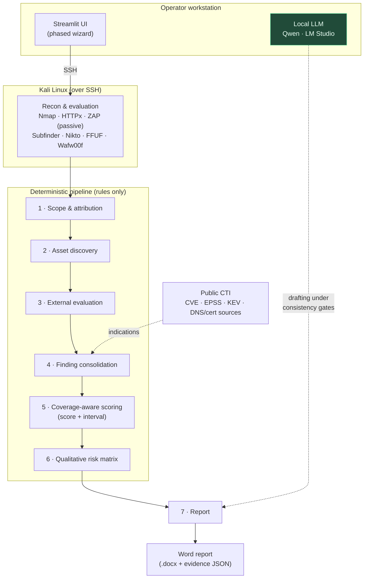

# External Posture (v25)


A phased, Streamlit-based tool for **authorized external security posture
assessment**. The app connects over SSH to a Kali host where the reconnaissance
and evaluation tools run, enriches findings with public cyber-threat
intelligence (CTI), computes a deterministic, coverage-aware score by rules, and
confines a **local LLM (Qwen via LM Studio)** to drafting the written report —
the model never changes the score, states, or risk.

The tool ships **no preconfigured credentials**: scope, Kali access, the Qwen
endpoint, and any API keys are entered in the interface.

> ⚠️ **Authorized use only.** Scan only targets you are **explicitly authorized**
> to test. All evaluation is non-intrusive (passive/observational); no
> exploitation or evasion is performed.

---

## Architecture



The LLM only **drafts prose**; the score, evidence states, and risk are computed
by deterministic rules and are never modified by the model. Public CTI enters as
corroborating *indications*, never as ground truth.

---

## Prerequisites

- **Python 3.11** (the dependency lock file is verified against Python 3.11.3).
- **LM Studio** running on your machine (or on the network), serving a **Qwen**
  model (e.g. `qwen/qwen3-4b-2507`) with its *Local Server* enabled. The model
  identifier must contain `Qwen`. This setup assumes LM Studio accepts the
  connection without authentication in your environment.
- **Kali Linux** reachable over **SSH** (same machine, a VM, or on the network)
  with the reconnaissance tools installed (see *Tools on Kali*) and **ZAP** with
  its API accessible locally.

---

## Installation

Clone the repository and create a virtual environment.

**Windows (PowerShell):**

```powershell
py -3.11 -m venv .venv
.\.venv\Scripts\python.exe -m pip install -r requirements.lock.txt
.\.venv\Scripts\python.exe -m streamlit run app.py
```

**Linux / macOS:**

```bash
python3.11 -m venv .venv
.venv/bin/python -m pip install -r requirements.lock.txt
.venv/bin/python -m streamlit run app.py
```

Then open **http://localhost:8501**.

`requirements.lock.txt` pins exact versions for a reproducible install. To run
the test suite, also install `requirements-dev.txt`.

---

## Configuration and workflow

The app guides you through phases:

1. **Project and authorized scope** — an owned domain and, optionally, your own
   public IPs. Ownership is never inferred from shared DNS, CDN, or ASN.
2. **Kali SSH** — IP, port, user, and password; fetch and verify the server
   fingerprint, then test the connection.
3. **Qwen / LM Studio** — enter the LM Studio URL and the exact ID of the loaded
   Qwen model, then test the connection.
4. **Public APIs** — fill in and check the external sources (DNSDumpster,
   public certificates, URLhaus, ThreatFox, Shodan). Errors are preserved; a
   Shodan 403 means an authorization/permission error, not an absence of
   results.
5. **Reconnaissance** — build the inventory. The full evaluation processes all
   eligible assets. A known complete inventory does not guarantee discovering
   every asset of an organization (discovery is a lower bound).
6. **Dashboards and posture** — automatic rule-based score, coverage, reasons,
   limits, and history.
7. **Findings** — one condition per application/origin, with affected paths,
   corroborations, and evidence. Qualitative risk (Low/Medium/High/Critical)
   comes from a documented matrix — no invented CVSS values.
8. **Report** — evidence is captured with Kali connected and explanations are
   drafted with Qwen under bounded automatic consistency controls; contradictory
   text is rejected and the catalog explanation is kept. The model receives the
   organization, target, methodology, score, dimensions, findings, and public
   intelligence as data — never as instructions — and never changes the score.
   The Word download includes a cover page, business summary, priorities,
   controls, findings with evidence, and appendices.

---

## Tools on Kali

Nmap with TLS/web NSE scripts, Subfinder, public DNS via `dig`, HTTPx Toolkit,
optional Findomain, Katana, historical sources, Wafw00f, Nikto, FFUF, and
Chromium for screenshots. ZAP must be installed with its API accessible locally
and the Client Spider available. The profile is Client Spider plus passive
analysis — no active scanning. LM Studio serves Qwen from the configured
machine; Streamlit connects to that server to draft the report.

---

## Evidence

Browser screenshots attest to the view; captures of recorded outputs show only
data gathered by the tools and are labeled as such (no simulated live terminal).
Original results remain in the JSON. Previous checkpoints can be loaded; the
score is recomputed by rules and observations are consolidated. Evidence that
cannot be safely linked is archived, not reassigned.

---

## Email and DNS

SPF is checked on the evaluated domain without inferring inheritance. DMARC looks
for a direct record and for policies in ancestors up to the registrable domain.
This is a bounded publication check: it does not verify message alignment or
delivery. RDAP uses the registrable domain identified via the local PSL bundled
with `tldextract`. DKIM remains *Not evaluated* without a known public selector.

---

## Testing

Local tests with simulated responses (HTTP/HTTPS, deficient headers, blocked
access, inherited/ambiguous DMARC, RDAP, the Qwen/LM Studio contract,
consolidation, retries, narrative consistency, score isolation, and ZAP):

```bash
python -m pytest        # suite under tests/ (see pytest.ini)
```

Legacy standalone checks (`python test_v20.py`, `python test_v18.py`, etc.) are
also available. These do not replace a real run against your own Kali or a call
with your own API accounts.

---

## Project status

Experimental. The scoring model and its weights are a declared normative choice;
academic calibration is ongoing. This tool accompanies research on
coverage-aware external posture scoring and the measured contribution of a local
LLM to security reporting.

## License

MIT — see [LICENSE](LICENSE).
